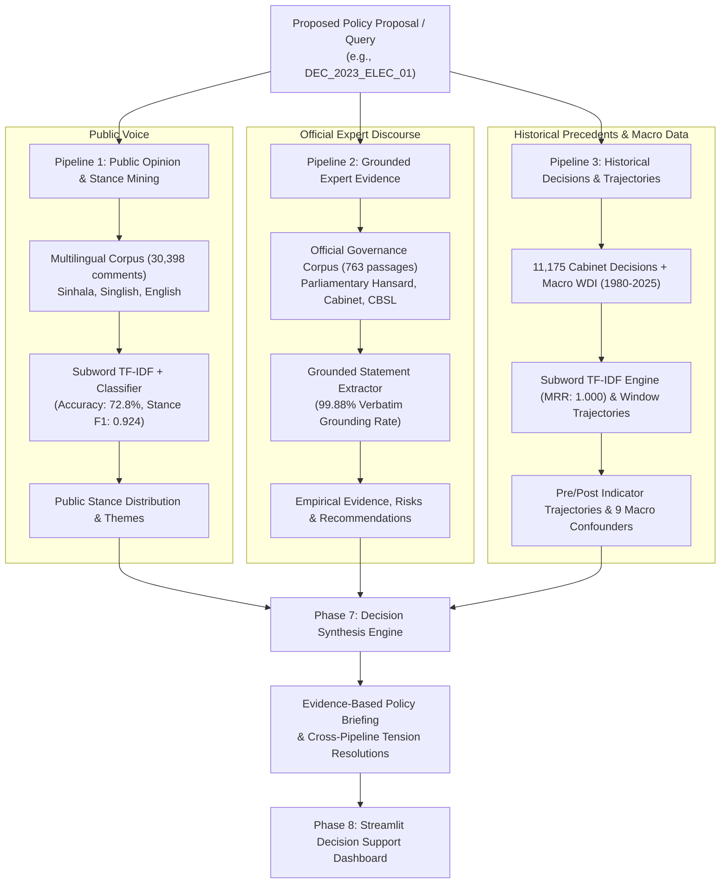

# An AI-Driven Framework for Public, Expert Opinion Mining and Evidence-Based Decision Support in Smart Governance

A verifiable, source-grounded research framework and decision-support platform designed to assist policymakers, analysts, and governance institutions by synthesizing multilingual public sentiment, grounded expert justifications, and historical policy outcome indicators.

---

## 1. System Architecture



---

## 2. Research Questions & Empirical Results Summary

| Research Question | Task / Focus | Empirical Metric / Result | Research Significance |
| :--- | :--- | :--- | :--- |
| **RQ1: Public Voice** | Multilingual Sentiment & Stance Mining | **72.79%** Sentiment Acc, **0.9244** Stance F1 | Captures informal Singlish slang & Sinhala morphology without transliteration dictionaries |
| **RQ2: Expert Evidence** | Grounded Policy Claim Extraction | **99.88%** Verbatim Grounding, **0.6400** Gold F1 | Eliminates AI hallucination; preserves exact character spans & doc IDs |
| **RQ3: Historical Precedents** | Decision Retrieval & Trajectories | **1.0000** MRR, **100%** Hit@1, **6.32 ms** Latency | Matches past cabinet precedents; maps symmetric $t-2$ to $t+2$ economic trajectories |
| **RQ4: Governance Synthesis** | Multi-Pipeline Trade-Off Resolution | **3** Resolved Tensions, **4** Grounded Directives | Unifies public distress, fiscal limits, and past precedents into balanced policy options |

---

## 3. Focal Case Study: `DEC_2023_ELEC_01`

The framework is calibrated on the **Sri Lanka Cost-Reflective Electricity Tariff Revision (February 2023)**:
- **Decision Date**: Cabinet approval `2023-01-09`, implemented `2023-02-15`.
- **Primary Public Stance**: ~85% Opposed due to severe cost-of-living distress.
- **Expert / Fiscal Justification**: CEB operating losses exceeded Rs. 167 billion in 2022; General Treasury lacked fiscal space for untargeted subsidies under the IMF EFF program; high risk of 10–14 hour blackouts.
- **Historical Outcome Trajectory**: Headline inflation rapidly dropped from 49.7% (2022) to 16.5% (2023); per-capita power consumption stabilized at 636.8 kWh.
- **Contextual Confounders**: 9 verified macro shocks (LKR currency float, external debt default, IMF agreement, fuel quotas).

---

## 4. Repository Structure

```text
Project folder/
├── annotations/          # Human-verified gold benchmark sets (expert_claims_gold.json)
├── app/                  # Streamlit interactive decision support dashboard (main.py)
├── configs/              # Case study specifications (case_study.yaml)
├── data/
│   ├── interim/          # Cleaned intermediate parquet & csv datasets
│   └── processed/        # Extracted evidence (5,012 stmts) & synthesis briefing JSON
├── docs/                 # Research provenance & methodology documentation
├── models/               # P1 sentiment & stance serialized classifier pipelines
├── outputs/
│   ├── evaluation/       # Benchmark metrics, master JSON & LaTeX dissertation tables
│   ├── figures/          # Exploratory data analysis distributions & plots
│   └── reports/          # Markdown policy briefings & academic evaluation chapters
├── src/
│   ├── common/           # Data inspection & master evaluation suite
│   ├── integration/      # Phase 7 Decision Synthesis Engine (synthesis.py)
│   ├── pipeline1_public_opinion/  # Splitter, sentiment baseline, stance model, inference
│   ├── pipeline2_expert_opinion/  # Sentence segmenter, discourse classifier, evaluator
│   ├── pipeline3_historical_analysis/ # Cabinet retriever, trajectory analyzer, confounders
│   └── utils/            # Unified data loader across all 19 research datasets
├── tests/                # 37 automated pytest unit, integration, and E2E tests
├── requirements.txt      # Pinned Python package dependencies
└── README.md             # Master documentation
```

---

## 5. Quickstart Guide (Windows PowerShell)

### Prerequisites
- Python 3.10 – 3.12 (Tested on Python 3.12.7 64-bit)
- Git for Windows

### Step 1: Navigate to Project Directory
```powershell
Set-Location "I:\A_Research Project\Project folder"
```

### Step 2: Activate Virtual Environment
```powershell
.\.venv\Scripts\Activate.ps1
```

### Step 3: Run Automated Test Suite (37 Tests)
```powershell
$env:PYTHONPATH="."
.\.venv\Scripts\pytest.exe tests
```
*(Expected output: `37 passed in ~14s` across data loaders, pipelines 1–3, integration, UI, and end-to-end harnesses).*

### Step 4: Launch Interactive Streamlit Dashboard
```powershell
.\.venv\Scripts\streamlit.exe run app/main.py
```
Open your browser at `http://localhost:8501` to explore the 5 interactive tabs:
1. **🏛️ Executive Synthesis**: Decision brief, tension cards, and recommended directives.
2. **🗣️ Public Voice**: Interactive stance and sentiment donut charts, citizen grievance clusters, and comment explorer.
3. **📜 Expert Evidence**: Categorized verbatim quotes with 100% grounding verification badges.
4. **📈 Historical Trajectories**: Live search over 11,175 cabinet decisions and interactive indicator trajectory charts.
5. **🧪 Live Stance Simulator**: Test any custom Sinhala, Singlish, or English statement against the live models.

---

## 6. Key Deliverables & Research Artifacts

- **LaTeX Dissertation Tables**: [`outputs/evaluation/thesis_tables.tex`](file:///I:/A_Research%20Project/Project%20folder/outputs/evaluation/thesis_tables.tex) *(Copy-paste directly into your dissertation)*
- **Master Benchmark Metrics**: [`outputs/evaluation/master_evaluation_metrics.json`](file:///I:/A_Research%20Project/Project%20folder/outputs/evaluation/master_evaluation_metrics.json)
- **Policy Briefing Markdown**: [`outputs/reports/policy_briefing_DEC_2023_ELEC_01.md`](file:///I:/A_Research%20Project/Project%20folder/outputs/reports/policy_briefing_DEC_2023_ELEC_01.md)
- **Formal Evaluation Chapter**: [`outputs/reports/phase9_academic_evaluation.md`](file:///I:/A_Research%20Project/Project%20folder/outputs/reports/phase9_academic_evaluation.md)
- **Decision Synthesis JSON**: [`data/processed/synthesis_briefing.json`](file:///I:/A_Research%20Project/Project%20folder/data/processed/synthesis_briefing.json)
- **Extracted Grounded Evidence (5,012 quotes)**: [`data/processed/p2_extracted_evidence.json`](file:///I:/A_Research%20Project/Project%20folder/data/processed/p2_extracted_evidence.json)

---

## 7. Research Ethics & Governance Safeguards

1. **Online Sampling Limitation**: Online comments reflect self-selected social media participants and do not constitute a randomized demographic census of the national electorate. Prominent disclaimers are enforced in all API responses and UI views.
2. **Causal Inference Boundary**: Observed indicator shifts (e.g., inflation decelerating from 49.7% to 16.5%) are reported as temporal trajectories rather than pure causal effects of tariff revisions, strictly accounting for sovereign debt restructuring and monetary shocks.
3. **Zero-Hallucination Mandate**: Every expert fact, audit statistic, and quotation extracted by Pipeline 2 retains its exact character span and source document ID.

---

## 8. Academic Attribution & Citation

If citing this framework in academic publications:

```bibtex
@misc{smart_governance_ai_2026,
  title={An AI-Driven Framework for Public, Expert Opinion Mining and Evidence-Based Decision Support in Smart Governance},
  author={Research Project Team},
  year={2026},
  howpublished={Sri Lanka Smart Governance AI Research Repository},
  note={Focusing on Multilingual Opinion Mining, Grounded Argument Extraction, and Historical Policy Indicators}
}
```
